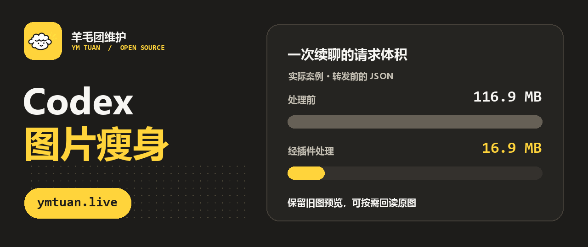

[](https://ymtuan.live/)

# Yangmao · Codex Image Slim

**Maintained by [Yangmao · ymtuan.live](https://ymtuan.live/).** [简体中文](README.md) · [Issues](https://github.com/PigeonAI-Yang/yangmao-magpie-image-slim/issues)

Codex can resend old images every time you continue a chat. This Magpie plugin keeps the current images at full resolution when possible, sends previews for images from the previous five turns, and replaces older images with text. A real Yangmao session went from **116.9 MB to 16.9 MB** of JSON at the gateway. The session continued and reopened a full-resolution image by its local reference.

## Install

First verified on Windows with Codex and Magpie 0.1.3960. Connect Codex to Magpie before installing. Image previews require Python 3.11 and Pillow.

```powershell
python -m pip install Pillow
magpie plugin add github:PigeonAI-Yang/yangmao-magpie-image-slim
```

You can also look for **Yangmao · Image Slim** in Magpie’s **Plugins → Discover → Unofficial**. If you use the standalone Windows executable, you can run the same subcommands with its full path.

Open the plugin's options and save `"gatewayTimeoutMs": 15000` in the JSON to give large batches time to process. The initial model scope is Magpie's `codex/*` routes.

## Use

Continue your existing Codex chat. The default JSON budget is **70 MB** and the preview threshold is **12 MiB**. In plugin settings, use `request_budget_bytes` to change the budget, `preview_turns` to set the history window, and `python_path` to select a specific interpreter. Set `gatewayTimeoutMs` to `15000` for large batches.

Codex cross-chat dispatches start a new turn. The plugin prioritizes originals for direct attachments, the most recent reference images read by a tool, and the latest generated batch. Earlier images follow the history rules.

For DeepSeek Harness image requests through Magpie, the plugin also supports Chat Completions and Responses. It prioritizes current attachments and the latest batch of tool images, and keeps previews from the previous five turns where possible. Set `dsh_budget_bytes` to change its separate 8 MB budget. Enable the local cache to reopen originals by path.

Historical inline audio becomes a text reference. Existing transcripts and other tool output remain available. GPT‑6.2 Sol can reject raw audio, so the plugin replaces current-turn audio on that route too. Other matching routes still receive current-turn audio. Set `"keep_audio": true` when your model supports audio and you need full audio replay. The optional local cache and recovery flow also support common audio formats such as WAV and MP3.

Original-image recovery is optional. Set `archive_path` to a local cache directory. To recover files after eviction, also set `codex_history_path` to the local Codex data directory. The fallback looks for a matching SHA-256 in that chat’s local record. The record needs to still contain the embedded image. If the cache would exceed 1 GiB, it removes its oldest originals toward a 512 MiB target.

Turn the plugin off with `magpie plugin off yangmao-magpie-image-slim`.

## Credits

This project builds on Euan Guo’s [magpie-middleware-image-slim](https://github.com/euanguo/magpie-middleware-image-slim). The original copyright and [MIT license](LICENSE) are included. Yangmao maintains this edition.
